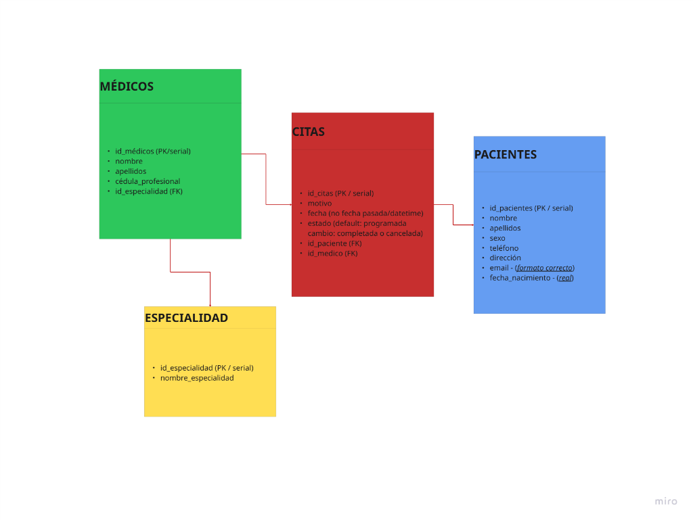
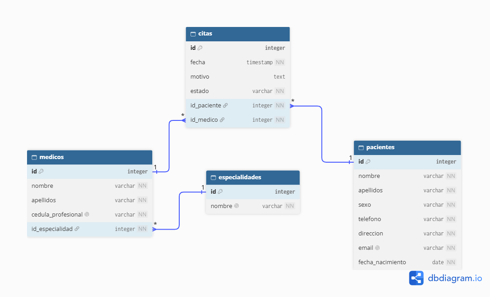

# Levantamiento de Requerimientos — Clínica Salud Integral

## 

## 1. Entidades Principales

Se identificaron 4 entidades del caso de negocio:

1. **Especialidad:** Catálogo de áreas médicas de la clínica.
2. **Médico:** Profesionales de la salud que brindan atención.
3. **Paciente:** Personas registradas para recibir consulta médica.
4. **Cita:** Encuentro programado entre un paciente y un médico en una fecha y hora específica.

---

## 2. Atributos de cada Entidad

### Tabla: `especialidades`

| Atributo | Tipo de Dato        | Notas                              |
| :------- | :------------------ | :--------------------------------- |
| `id`     | Entero (Serial)     | [PK], Autoincremental, Obligatorio |
| `nombre` | Texto (VarChar 100) | Obligatorio, Único                 |

### Tabla: `medicos`

| Atributo             | Tipo de Dato        | Notas                                          |
| :------------------- | :------------------ | :--------------------------------------------- |
| `id`                 | Entero (Serial)     | [PK], Autoincremental, Obligatorio             |
| `nombre`             | Texto (VarChar 50)  | Obligatorio                                    |
| `apellidos`          | Texto (VarChar 100) | Obligatorio                                    |
| `cedula_profesional` | Texto (VarChar 100) | Obligatorio, Único                             |
| `id_especialidad`    | Entero              | [FK] apunta a `especialidades.id`, Obligatorio |

### Tabla: `pacientes`

| Atributo           | Tipo de Dato        | Notas                                       |
| :----------------- | :------------------ | :------------------------------------------ |
| `id`               | Entero (Serial)     | [PK], Autoincremental, Obligatorio          |
| `nombre`           | Texto (VarChar 50)  | Obligatorio                                 |
| `apellidos`        | Texto (VarChar 100) | Obligatorio                                 |
| `sexo`             | Texto (VarChar 20)  | Obligatorio                                 |
| `telefono`         | Texto (VarChar 20)  | Obligatorio                                 |
| `direccion`        | Texto (VarChar 300) | Obligatorio                                 |
| `email`            | Texto (VarChar 150) | Obligatorio, Único, Formato de email válido |
| `fecha_nacimiento` | Fecha (Date)        | Obligatorio, Fecha no futura                |

### Tabla: `citas`

| Atributo      | Tipo de Dato                           | Notas                                                                           |
| :------------ | :------------------------------------- | :------------------------------------------------------------------------------ |
| `id`          | Entero (Serial)                        | [PK], Autoincremental, Obligatorio                                              |
| `fecha`       | Marca de tiempo (Timestamp / DateTime) | Obligatorio, Fecha no pasada                                                    |
| `motivo`      | Texto                                  | Opcional                                                                        |
| `estado`      | Texto / Enum                           | Obligatorio, Default: 'PROGRAMADA' (Valores: PROGRAMADA, COMPLETADA, CANCELADA) |
| `id_paciente` | Entero                                 | [FK] apunta a `pacientes.id`, Obligatorio                                       |
| `id_medico`   | Entero                                 | [FK] apunta a `medicos.id`, Obligatorio                                         |

---

## 3. Relaciones entre Entidades

- **Especialidad y Médicos:** Una _Especialidad_ puede tener muchos _Médicos_, pero un _Médico_ pertenece a una sola _Especialidad_ (1:N).
- **Pacientes y Citas:** Un _Paciente_ puede tener muchas _Citas_, pero una _Cita_ pertenece a un solo _Paciente_ (1:N).
- **Médicos y Citas:** Un _Médico_ puede tener muchas _Citas_, pero una _Cita_ pertenece a un solo _Médico_ (1:N).
- **Pacientes y Médicos (Relación N:M):** Resuelta a través de la tabla intermedia con atributos propios: `citas`.

---

### Documentación del Modelo Relacional

## 

- **Enlace interactivo:** [Ver modelo en dbdocs.io](https://dbdocs.io/miguel-matamoros-cortesoutlookcom/Clinica-Salud-Integral)

---

## 4. Decisioneses de diseño y buenas prácticas

1. **¿Por qué Especialidad tiene su propia tabla?**

   La tabla especialidades por normalizacion de datos, evita redundancias al tener que repetir el nombre de la especialidad en cada médico y previene diferencias de escritura, como por ejemplo: “Cardiología” y “Cardio”.

2. **Manejo del Estado de la Cita:**

   Se definió un tipo de dato Enum (`EstadoCita`) con los valores `PROGRAMADA`, `COMPLETADA` y `CANCELADA`, con valor inicial `@default(PROGRAMADA)`. Esto garantiza integridad en la base de datos, evitando estados inválidos y modelando el ciclo de vida de la cita sin la limitación binaria de un booleano.

3. **Validación de Fechas (Reglas de Negocio con Zod):**

   Las restricciones temporales (fecha de nacimiento no futura y citas que no pueden agendarse en el pasado) se validan en la capa de entrada del backend mediante esquemas de **Zod** antes de consultar la base de datos. Esto protege el servidor, evita operaciones innecesarias en PostgreSQL y devuelve errores HTTP 400 claros al cliente.

4. **Tabla de Autenticación (`users`):**

   Se integra como componente de infraestructura técnica para el manejo de credenciales (JWT) y autorización por roles (RECEPCIONISTA, MEDICO, GERENCIA).

5. **Campos de User y asignación del rol:**

   Para iniciar sesión, email y contraseña son suficientes; ya que el email es único. El rol también se almacena para decidir qué acciones puede realizar la cuenta, pero no es una credencial de inicio de sesión. Aunque podrían agregarse nombre y apellidos, no son necesarios para el alcance actual.
   _NOTA:_
   En una aplicación real, el servidor no debe confiar en el rol enviado por el usuario al registrarse: debe asignar un rol permitido y reservar los roles privilegiados para un proceso autorizado.
